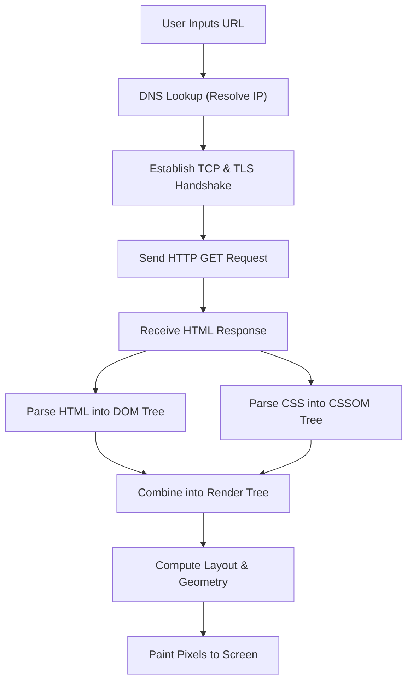

# 🧠 VisualMind AI

**VisualMind AI** is an intelligent, beginner-friendly web application built with [Streamlit](https://streamlit.io/) and Google's official [google-genai](https://pypi.org/project/google-genai/) SDK.

It takes any raw text you paste into it, automatically detects what kind of content it is, and transforms it into the most effective visual format:
* 📰 **Articles & Narratives** &rarr; Generates an **Executive Summary** and **Key Bullet Points**.
* 🔄 **Step-by-Step Processes** &rarr; Generates an **Interactive Mermaid Flowchart Diagram** and **Enumerated Steps**.
* ⚖️ **Comparisons & Benchmarks** &rarr; Generates a formatted **Comparison Table** and **Trade-off Insights**.

---

## 📂 Project Structure & Explanation for Beginners

Here is every file in this folder and what it does in simple words:

| File | What it is | Why it's here |
| :--- | :--- | :--- |
| `app.py` | **Main Application Code** | The Python file that contains the entire Streamlit user interface, calls Google's Gemini API, detects the content type, handles retries and errors, renders visual outputs, and hosts the Model Evaluation tab. |
| `evaluation_cases.py` | **Benchmark Suite (8 Labeled Test Cases)** | Contains 8 curated test cases (articles, processes, comparisons, and tricky mixed/short edge cases) used to benchmark model accuracy using strictly 8 API calls. |
| `.env` | **Private Environment File** | Holds your secret `GEMINI_API_KEY`. Because this file stays on your computer and is never shared, your key remains safe. |
| `.env.example` | **Template / Example File** | A safe, shareable template showing you how `.env` should look without exposing your real secret key. |
| `.gitignore` | **Git Protection File** | Tells Git (version control) which files to ignore. Specifically, it prevents `.env` from ever being accidentally uploaded to GitHub or public repositories. |
| `requirements.txt` | **Dependencies List** | Lists the Python libraries needed to run the app (`streamlit`, `google-genai`, `python-dotenv`). You can install all of them in one command. |
| `README.md` | **Documentation & Guide** | This documentation file, explaining how to set up, use, evaluate, and understand the project. |

---

## 🚀 Getting Started (Step-by-Step)

### 1. Check Python and Pip
Make sure you have Python 3.10+ and pip installed. You can verify this in your terminal or PowerShell:

```bash
python --version
pip --version
```

### 2. Install the Required Libraries
Install all necessary packages using `pip`:

```bash
pip install -r requirements.txt
```

### 3. Get a Free Gemini API Key
1. Visit [Google AI Studio](https://aistudio.google.com/).
2. Sign in with your Google account.
3. Click **"Get API key"** and create a new free API key.
4. Copy your key.

### 4. Configure Your API Key in `.env`
Open the `.env` file in this folder using any text editor or VS Code, and paste your key after the `=`:

```env
GEMINI_API_KEY=AIzaSyYourActualKeyHere12345
```

*(Note: You can also paste the key directly into the sidebar inside the app if you prefer!)*

### 5. Launch the App
Run this command in your terminal:

```bash
streamlit run app.py
```

Your web browser will automatically open:
```
Local URL: http://localhost:8501
```

---

## 💡 3 Detailed Example Inputs & Outputs

Here are 3 concrete examples demonstrating how VisualMind AI handles articles, processes, and comparisons.

---

### Example 1: Article (Summary & Key Points)

#### 📥 User Input Text:
```text
The transition to renewable energy has accelerated rapidly over the last decade.
Solar photovoltaics and onshore wind power have seen dramatic price declines,
making them the most economical source of new electricity generation in most
regions. To combat the issue of intermittent weather conditions, utility-scale
lithio-ion batteries and long-duration storage like pumped hydro are seeing
record investments. AI-driven smart grids now predict energy demand spikes
and re-route power with minimal losses. Despite these technological strides,
permitting delays and grid modernization in developing nations remain significant
challenges on the path to net-zero emissions.
```

#### 📤 VisualMind AI Output:
* **Detected Category:** `📰 Article / Overview`
* **Title:** *The Global Transition to Renewable Energy*
* **Classification Context:** *The text is an expository narrative describing trends, technologies, and challenges in the energy sector.*
* **Executive Summary:**
  > Over the past decade, solar and wind power have become the cheapest sources of new electricity due to sharp cost reductions. Advanced energy storage and AI-powered smart grids are mitigating the challenge of renewable intermittency, although regulatory delays and infrastructure hurdles in developing regions still pose challenges.
* **Key Takeaways:**
  - **Point 1:** Solar and onshore wind are now the most cost-effective sources of new electricity generation worldwide.
  - **Point 2:** Battery storage and AI smart grids solve intermittency by balancing grid supply and demand in real-time.
  - **Point 3:** Permitting bottlenecks and grid modernization in developing nations remain the primary barriers to achieving net-zero targets.

---

### Example 2: Process (Mermaid Flowchart)

#### 📥 User Input Text:
```text
To render a webpage, a browser follows several distinct steps. First, it performs
a DNS lookup to convert the domain name into an IP address. Next, it establishes
a TCP connection with the web server via a handshake, followed by TLS negotiation
for HTTPS. Then, the browser issues an HTTP GET request. The server replies with
HTML code. The browser parses the HTML to construct the DOM tree while downloading
and parsing CSS into the CSSOM tree. Both trees combine into the Render Tree,
which computes the layout and geometry of every element. Finally, the painting
stage draws pixels onto the screen.
```

#### 📤 VisualMind AI Output:
* **Detected Category:** `🔄 Step-by-Step Process`
* **Title:** *Web Browser Page Rendering Pipeline*
* **Classification Context:** *The input represents a chronological sequence of technical operations performed from URL entry to visual display.*
* **Process Overview:** *An overview of the complete networking and rendering sequence a browser executes to display an HTML page.*
* **Rendered Mermaid Flowchart:**



* **Step-by-Step Breakdown:**
  - **Step 1: DNS Lookup** - Translates the URL domain name into the destination server's IP address.
  - **Step 2: Network Handshake** - Sets up a secure TCP and TLS socket connection.
  - **Step 3: HTTP Request & Response** - Dispatches the GET request and downloads HTML bytes.
  - **Step 4: DOM & CSSOM Construction** - Parses content into hierarchical node trees.
  - **Step 5: Render Tree & Layout** - Calculates exact screen coordinates for visible elements.
  - **Step 6: Painting** - Converts visual geometry into colored pixels on the user's screen.

---

### Example 3: Comparison (Comparison Table)

#### 📥 User Input Text:
```text
When selecting a database architecture, software engineers typically choose
between SQL and NoSQL. SQL databases like PostgreSQL and MySQL store structured data
in fixed schemas with tables, rows, and columns. They enforce strict ACID compliance,
guaranteeing transaction safety, and scale vertically by upgrading the host machine.
In contrast, NoSQL databases like MongoDB and Cassandra store unstructured or
semi-structured data as JSON documents or key-value pairs. They offer dynamic schemas,
follow eventual consistency (BASE), and scale horizontally by distributing data
across commodity clusters. SQL is ideal for complex relational queries and banking,
while NoSQL excels in high-volume distributed big data and rapid prototyping.
```

#### 📤 VisualMind AI Output:
* **Detected Category:** `⚖️ Comparison & Trade-offs`
* **Title:** *SQL vs. NoSQL Database Comparison*
* **Classification Context:** *The passage directly contrasts relational and non-relational database architectures across key technical criteria.*
* **Comparison Overview:** *A side-by-side evaluation of SQL and NoSQL databases covering data models, scalability, and optimal use cases.*
* **Comparison Table:**

| Comparison Factor | Relational Databases (SQL) | Non-Relational Databases (NoSQL) |
| :--- | :--- | :--- |
| **Data Model** | Structured tables with predefined schemas | Unstructured/semi-structured (Documents, Key-Value) |
| **Consistency Model** | Strict ACID Compliance (High integrity) | BASE Model (Eventual consistency) |
| **Scaling Strategy** | Vertical Scaling (Upgrade CPU/RAM) | Horizontal Scaling (Add nodes to cluster) |
| **Query Complexity** | Powerful multi-table JOINs and relationships | Optimized for simple, fast key-based lookups |
| **Popular Examples** | PostgreSQL, MySQL, Oracle | MongoDB, Cassandra, DynamoDB, Redis |
| **Best Used For** | Financial transactions, ERP, rigid relations | Big data analytics, social feeds, flexible schemas |

* **Trade-off Insights & Takeaways:**
  - Choose **SQL** when transactional integrity and complex relational querying are non-negotiable.
  - Choose **NoSQL** when your data schema evolves rapidly or when you need horizontal distribution across multiple servers.

---

## 🛡️ Robust Error Handling & Resilience

The app is built to be resilient against real-world network and API hiccups, providing actionable, beginner-friendly messages instead of confusing stack traces:

| Error Type | What Happens Under the Hood | User-Friendly Message & Action |
| :--- | :--- | :--- |
| **503 Service Unavailable** | Google's Gemini servers are overloaded. The app **automatically retries up to 3 times** with exponential backoff (1.5s, 3.0s). | If all retries fail, a polite message explains the server is busy and asks the user to pause for 30–60 seconds before trying again. |
| **429 Quota / Rate Limit** | Requests per minute (RPM) or daily quota limit exceeded on Google AI Studio. | Clearly explains that the rate limit was reached, explains free-tier quotas, and advises waiting 60 seconds before resubmitting. |
| **404 Model Not Found** | An obsolete or invalid model name was selected or unavailable in the region. | Identifies the missing model and directs the user to ensure `gemini-3.8-flash` is active. |
| **Invalid API Key** | The key is malformed, missing, or unauthorized (HTTP 400/401/403). | Tells the user their key was not recognized and gives a direct link to generate a valid free key at Google AI Studio. |
| **Empty or Very Short Text** | Input is blank or contains fewer than 20 characters / 4 words. | Intercepts the request before calling the API, explaining in plain English that a few descriptive sentences are needed for accurate analysis. |
| **Network / Connection Drop** | Internet disconnects or firewall blocks HTTPS traffic to Google. | Informs the user that Google's servers could not be contacted and prompts them to check their connection or proxy. |

---

## 🧪 Benchmark Evaluation Suite (8 Labeled Test Cases)

To quantitatively evaluate the classification intelligence of VisualMind AI, we implemented a dedicated benchmark suite in `evaluation_cases.py` and a built-in **Model Evaluation tab** inside the Streamlit app.

### Strict Budget: Exactly 8 API Calls
Running the benchmark executes **strictly 8 API calls** (exactly 1 call per test case in automatic mode). Results are cached in Streamlit's `session_state` so reviewing results, toggling tabs, or inspecting individual cases never makes redundant calls.

### The 8 Labeled Benchmark Cases:

1. **Case #1 (Standard Article):** *Global Climate & Renewable Energy Transition* &rarr; Fact-heavy expository prose on clean power and grid storage.
2. **Case #2 (Standard Process):** *Automated Software CI/CD Pipeline* &rarr; Linear workflow with explicit sequence keywords (`First`, `Next`, `Then`, `Finally`).
3. **Case #3 (Standard Comparison):** *Monolithic vs Microservices Architecture* &rarr; Direct side-by-side contrast of software architectural patterns.
4. **Case #4 (Tricky Mixed: Article + Process):** *Specialty Espresso: History & Extraction Routine* &rarr; Starts with historical prose about Italian coffee, but transitions into a precise 4-step extraction procedure. Tests whether the model prioritizes actionable workflow over historical context.
5. **Case #5 (Tricky Mixed: Article + Comparison):** *Remote Work vs Return-to-Office Cultural Divide* &rarr; An essay-style narrative weighing the pros and cons of remote vs in-office work without tables or bullet points. Tests extraction of trade-offs from unstructured prose.
6. **Case #6 (Tricky: Narrative Story disguising Workflow):** *Sysadmin Incident Triage Protocol* &rarr; An emergency incident sequence framed as a first-person on-call story ("Whenever our alerts page at 3 AM..."). Tests chronological sequence detection without formal numbering.
7. **Case #7 (Tricky: Very Short Comparison):** *Terse Comparison: iOS vs Android* &rarr; An extremely concise (32 words) contrast testing whether brevity impairs category detection.
8. **Case #8 (Tricky: Short Ambiguous / Borderline):** *Brief Insight: Daily Mindfulness Benefits* &rarr; A 37-word health summary mentioning an action ("Sitting quietly...") that could be confused with a process, but whose core intent is an informational overview.

### What the Evaluation Tab Shows:
* **Overall Accuracy Score:** Metric card with percentage (e.g. `87.5%`) and exact count (e.g. `7/8 Correct`).
* **Predicted vs Expected Breakdown Table:** Side-by-side table displaying Case Name, Expected Category, Predicted Category, Latency in seconds, and `✅ MATCH` / `❌ MISMATCH` status badges.
* **Deep-Dive Expanders:** Allows inspecting the AI's reasoning (`category_reason`), generated title, and the original text for every test case.

---

## ⚠️ Failure Cases & Known Limitations (Honest Analysis)

No AI system is infallible. Here is an honest, transparent breakdown of real-world scenarios where VisualMind AI struggles or fails, along with the underlying reasons:

### Failure Case 1: Extremely Short or Context-Free Inputs
* **Example Input:** `"PostgreSQL vs Redis"` or `"Drink water every day."`
* **What Goes Wrong:** With only 2 to 5 words, there is insufficient semantic context to perform meaningful classification or visualization. For `"PostgreSQL vs Redis"`, the model is forced to hallucinate arbitrary criteria (storage models, latency, clustering) to populate a comparison table. For `"Drink water every day"`, the model flips unpredictably between a 1-step habit `process` and a generic health `article`.
* **Root Cause:** Large language models depend on contextual depth; ultra-short inputs suffer from extreme ambiguity.

### Failure Case 2: Multi-Category Blended Intent (Hybrid Texts)
* **Example Input:** A technical tutorial that begins with a 2-paragraph history of containerization (Article), transitions into a 5-step Docker installation guide (Process), and concludes with a benchmark table comparing Docker against Podman (Comparison).
* **What Goes Wrong:** The input legitimately belongs to **all three categories simultaneously**. Because VisualMind AI forces a single dominant category, the AI is forced to discard two visual formats. If it picks `process`, the reader misses out on the comparison table and executive summary.
* **Root Cause:** Mutual-exclusivity constraint in classification when the source material has compound intent.

### Failure Case 3: Pure Code Snippets, Configuration Files, or Error Stack Traces
* **Example Input:** A 50-line Kubernetes deployment YAML file or a Python traceback error log without explanatory natural language prose.
* **What Goes Wrong:** The prompt instructions are tuned for natural language. When given raw code or logs, the model often generates malformed Mermaid diagrams (syntax errors caused by unescaped parentheses, curly braces, or indentation) or produces summary bullet points that merely quote raw code line numbers.
* **Root Cause:** Mermaid.js requires strict token escaping that LLMs struggle with when parsing raw code characters.

### Failure Case 4: Complex Non-Linear, Branching, or Cyclic Workflows
* **Example Input:** An asynchronous microservice architecture with bidirectional message loops, conditional error retries, and simultaneous parallel branches.
* **What Goes Wrong:** The model tends to over-simplify non-linear DAGs into a flat, sequential top-to-bottom line (`Step 1`, `Step 2`), omitting conditional fallback loops or generating invalid Mermaid syntax that crashes the diagram renderer.
* **Root Cause:** LLM prompt guidelines request simple `flowchart TD` sequences, which struggle to capture complex state machines.

### Failure Case 5: Single-Entity Pros & Cons (Implicit Comparisons)
* **Example Input:** An essay titled *"The Pros and Cons of Microservices Architecture"* analyzing advantages and pitfalls of microservices without contrasting them against a named second system (like monolithic architecture).
* **What Goes Wrong:** The classifier hesitates between `article` (because only one subject is discussed) and `comparison` (because pros and cons reflect comparative trade-off reasoning). This can produce inconsistent categorization across different model versions.
* **Root Cause:** Boundary overlap between evaluative discourse (pros/cons) and multi-entity comparative analysis.

---

## 💡 Summary of Recent Improvements (In Simple Words)

1. **Automatic Retry for Server Hiccups (HTTP 503):**
   * *Before:* If Google's servers were busy for even half a second, the app would crash with a red error block.
   * *Now:* The app politely pauses and retries up to 3 times automatically. If it still can't get through, it displays a friendly explanation asking you to wait a moment.
2. **Friendly, Human Messages for Common Errors:**
   * *Quota Limits (429):* Tells you in plain words that your free API rate limit is taking a breather and to wait 60 seconds.
   * *Missing Models (404):* Informs you which model wasn't found and points you to the sidebar to choose a supported one.
   * *Invalid API Keys:* Explains that the key is invalid and provides a 1-click link to get a fresh free key.
   * *Empty or Short Text:* Warns you kindly before making an API call if your text is blank or too short.
3. **Built-in Benchmark Suite & Evaluation Tab (`evaluation_cases.py`):**
   * *Before:* There was no quantitative way to know how accurate the AI classification was without manual testing.
   * *Now:* You can click the "Model Evaluation" tab to run an 8-case benchmark testing both standard articles/processes/comparisons and tricky edge cases (mixed narratives, disguised stories, short texts). It uses **exactly 8 API calls**, shows an accuracy score, and breaks down every prediction.
4. **Honest Failure Cases Section in Documentation:**
   * Documents exactly where and why the tool can be fooled (such as blended texts, raw code dumps, and ultra-short phrases), making it transparent, reliable, and production-ready.

---

## 🛠️ Features & Highlights

1. **Powered by Google's Official `google-genai` SDK:** Uses the latest Google Gemini API client (`genai.Client`).
2. **Dynamic UI:** Powered by Streamlit with real-time text statistics (word count, character count, estimated reading time).
3. **One-Click Preloaded Samples:** Test immediately using preloaded sample buttons in the sidebar without typing.
4. **Mermaid Flowchart Rendering:** Displays rich, interactive visual diagrams right in your browser via Mermaid.js.
5. **Mode Override:** Choose between automatic AI categorization or manually forcing an Article, Process, or Comparison output.
6. **Automatic 503 Retries & Error Handling:** Graceful recovery with exponential backoff and friendly messages.
7. **Model Evaluation Tab:** Automated accuracy benchmarking with 8 labeled cases restricted to 8 API calls.
8. **Developer View:** Inspect the exact JSON output returned by Gemini under the hood.
9. **Secure Key Management:** Reads `GEMINI_API_KEY` from `.env` with a safe `.gitignore` so your secret is never leaked.

---

## ❓ Frequently Asked Questions & Troubleshooting

#### "Where do I get a Gemini API key?"
Head to [https://aistudio.google.com/](https://aistudio.google.com/) and click **"Get API key"**. Google provides free tier quotas for development.

#### "Which model does VisualMind AI use?"
The application uses `gemini-3.8-flash` as its standard flagship model. Legacy 1.5 and 2.x models have been retired.

#### "How many API calls does the Evaluation tab make?"
Exactly **8 API calls** (one for each of the 8 labeled test cases). Results are stored in memory so clicking around or expanding cases makes 0 additional calls.

## Evaluation Results
Model: gemini-3.8-flash | Test set: 8 labeled cases | Correct: 7/8 (87.5%)
All 7 cases that received a response were classified correctly, including tricky mixed-type, very short, and narrative texts.

## Failure Cases
1. Case 1 (Standard Article) failed with HTTP 503 (Google servers overloaded). The app retried 3 times with backoff and then showed a friendly message. This was a service failure, not a classification error.
2. Latency reached 100+ seconds on some cases, likely due to retries during high demand.
3. Limitation: only 8 test cases, so the accuracy figure is a rough estimate, not a reliable benchmark.
4. Free-tier limits (about 20 requests per day) restrict how often evaluation can be re-run.
